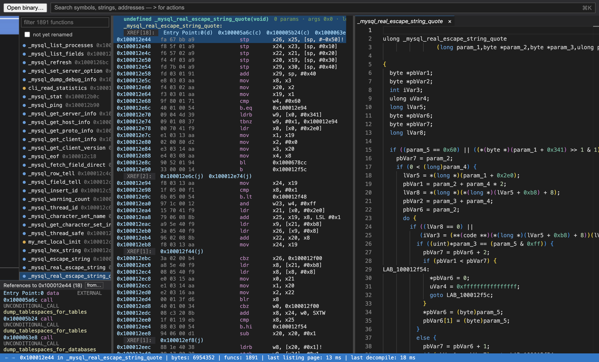

<p align="center"></p>

# Ghidrette

Ghidrette is a fast desktop reverse-engineering workspace on top of [Ghidra](https://github.com/NationalSecurityAgency/ghidra)'s analysis engine: Electron (TypeScript, React, Monaco) talking over a WebSocket JSON-RPC protocol to a headless Python sidecar (PyGhidra on the Ghidra JVM).

> **Status: early spike.** It works end to end on real binaries, but expect rough edges and breaking changes. Ghidrette is an independent project and is not affiliated with or endorsed by the Ghidra project or the NSA.



<sub>Function list, listing with cross-references and decompiler on `mysqldump` (arm64, 1,891 functions).</sub>

## What it does

- Address-based listing that stays fast on large binaries (no per-row index), with decompiler view, xrefs, strings, symbol/memory search
- Editing with Ghidra's default keys: rename, retype, comments, create function, define data, undo/redo, save
- Binary map, function coverage runs (A vs B), data type manager, import dialog with analysis profiles
- Analysis persists in a Ghidra project per file (sha256), so reopening skips re-analysis

## Getting started

Needs JDK 25, Python 3.10+, Node LTS and a Ghidra build. Full steps in [docs/DEVELOPMENT.md](docs/DEVELOPMENT.md).

```bash
cd app && npm install && npm start
```

## Repository layout

| Path | Contents |
|---|---|
| `app/` | Electron app (main, preload, renderer) |
| `sidecar/` | Python JSON-RPC sidecar around PyGhidra, with pytest suite |
| `protocol.md`, `protocol.ts` | The wire protocol between the two |
| `bench/` | Benchmark scripts and results |
| `packaging/` | macOS bundle preparation (`npm run dist`) |
| `SPIKE_REPORT.md` | Design decisions and measurements per round |

## License

No license has been granted. All rights reserved by the author; being publicly visible does not give anyone permission to use, copy, modify or distribute this code.
