<p align="center"></p>

# Ghidorita

Ghidorita is a fast desktop reverse-engineering workspace on top of [Ghidra](https://github.com/NationalSecurityAgency/ghidra)'s analysis engine: Electron (TypeScript, React, Monaco) talking over a WebSocket JSON-RPC protocol to a headless Python sidecar (PyGhidra on the Ghidra JVM).

> **Status: early spike.** It works end to end on real binaries, but expect rough edges and breaking changes. Ghidorita is an independent project and is not affiliated with or endorsed by the Ghidra project or the NSA.


<sub>Function list with the binary map, listing with cross-references, references panel and decompiler on `mysqldump` (arm64, 1,891 functions).</sub>

## Features and how to use them

Shortcuts are shown for macOS (use Ctrl on other platforms). Screenshots: `mysqldump` (arm64), `/usr/bin/zip`, `/usr/bin/vim` and `/bin/bash` (x86-64 Mach-O); the Calls, Bookmarks and Copy screenshots are `/bin/ls`.

### Open a binary
Drop a file anywhere on the window, or use File > Open Binary… (`Cmd+O`) or the start screen's **Drop a binary here** area (a button: Enter opens the file picker). One regular file at a time; a folder, several files, a drop while another binary is opening or while a dialog is up is refused with a message. With a program already open, a drop replaces it like File > Open Binary does (edits are saved first). Or reopen a program from the start screen's **Programs in this project** list (each with its size, analysis state, last opening and import options; **Delete** removes it). Before anything is analysed, an import card shows what the file is: format, architecture, entry point, size, an entropy strip over the whole file and every section with its size and entropy, so packed or encrypted regions stand out. Loader, language, compiler, base address and the Full/Fast analysis profile sit behind **Advanced options…** (Fast skips switch analysis, call-convention ID and stack analysis; it is the default above 20 MB). Analysis is stored per file (sha256), so reopening skips it.

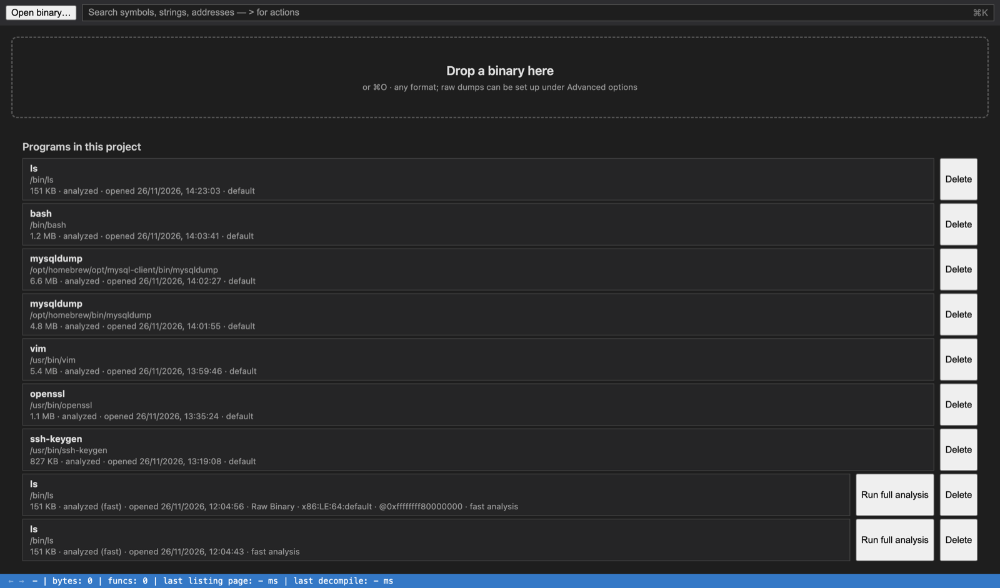

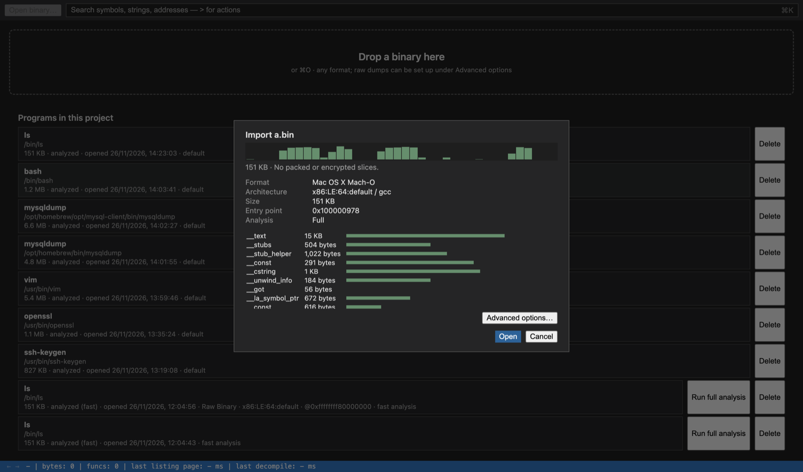

### Work while analysis runs
The workspace opens as soon as the import is saved; analysis keeps running in the background. The function list grows as functions are found, and listing, decompiler, search and graphs work on what is there so far. The status bar shows the running analyzer with **Cancel**. Edits are refused ("analysis running") until it finishes, because Ghidra would fold them into the analysis transaction. A cancelled or interrupted analysis is kept as *partial*: **Resume analysis** in the program list (or reopening it) continues it, and a Fast program offers **Run full analysis**, which runs only the analyzers Fast skipped.

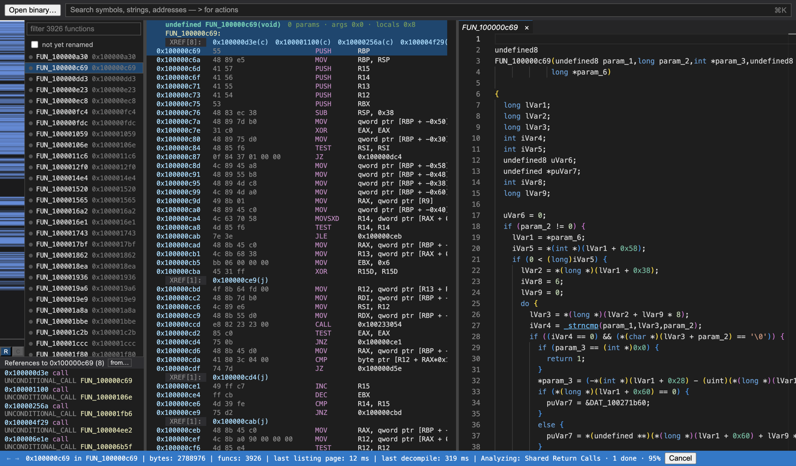

### Command bar (`Cmd+K`)
One bar for jumping, searching and actions. Empty, it lists ranked leads (entry point, the most used imports, strings and functions) with the reason each ranks high; source-file paths (`__FILE__` in asserts) and very short words are left out of the string leads. Type to search symbols, strings or an address; string hits show where they are used. Start with `>` for actions (rename, retype, open a panel, load coverage, toggle a graph, export, …); each action that has a key shows it on the right (`Rename  L`, `Call Graph  ⌘⇧G`). `Cmd+G` goes straight to an address; Back/Forward (`Cmd+[` / `Cmd+]`) live in the status bar.


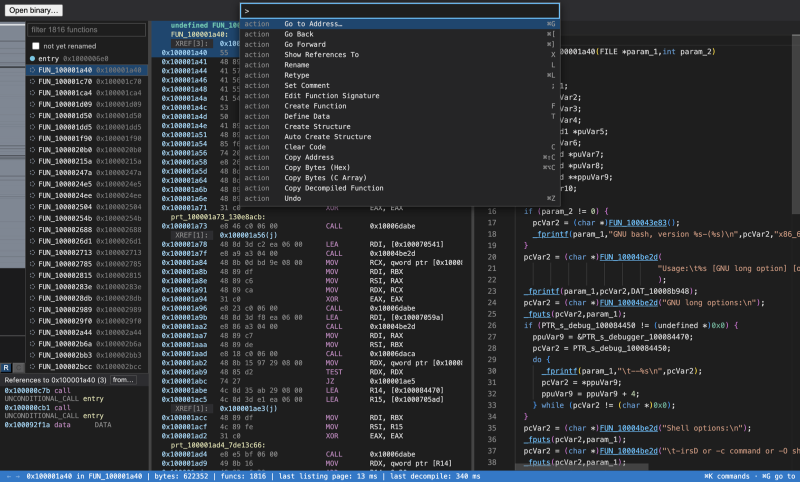

### Key hints and colours
The right side of the status bar lists the keys that work in the view you are in, taken from the same table as the menu and the command bar and limited to what the provider can do: listing `L rename · X refs · Space graph · ; comment · F function · T data · C clear`; decompiler `L rename · X refs · Space graph · ⌘L retype · ; comment`; graphs `Space back · wheel zoom · drag pan · Fit · 1:1`; elsewhere `⌘K commands · ⌘G go to`. The most used keys come first; a narrow window cuts the rest, hover the line for all of it.

Colours always come with a shape, so nothing depends on colour alone. Who named a function (function list, call graph): off-white solid dot = named by you, amber ring = named by analysis (a guess), light-blue solid dot = from the file (symbols, also when the demangler rewrote them) or a library signature, grey dashed ring = unnamed (`FUN_…`). Orange-red marks attention: code reached by only one coverage run. Green is the "both runs" tint.

### Read: function list, binary map, listing, decompiler, references
The function list filters by name; tick **not yet renamed** to see only functions nobody has named. The vertical binary map beside it shows the whole file; click or drag to go there, the map draws every function in grey, and its layers toggle with **R** (functions you named, off-white) and **C** (coverage); hovering a toggle says what its colours mean. The listing shows function headers, plate/pre/post/EOL/repeatable comments, all labels, `XREF[n]` annotations (click to follow) and folded structures and arrays (click the arrow or Left/Right), across all address spaces including overlays. The decompiler follows the cursor and opens one tab per function; click a call to go to the callee.

The panel under the function list shows the references to the cursor (calls, jumps, reads, writes, pointers, each with its function). `X` on a listing row or decompiler token (or Go > Show References To) pins it to that target, **Follow cursor** unpins it, and **from…** lists what the current instruction references. `X` on a decompiler temporary (`iVar1`) lists where it is written and read.

### Control-flow graph (`Space`)
`Space` in the listing or decompiler (or View > Control-Flow Graph) swaps the decompiler for the function's graph. Blocks show C where the decompiler maps them, otherwise assembly; edges are told apart by line style as well as colour: true is blue and solid, false is orange and dashed, a jump is thin grey, and a loop-back edge (its target starts at or before its source) is dotted. A graph that would only fit at an unreadable size opens at actual size on the cursor's block instead; **Fit** shows the whole graph, **1:1** returns to the cursor's block, and the view follows the cursor when it moves to a block off screen. Wheel zooms, drag pans, a click on a block moves the cursor there.

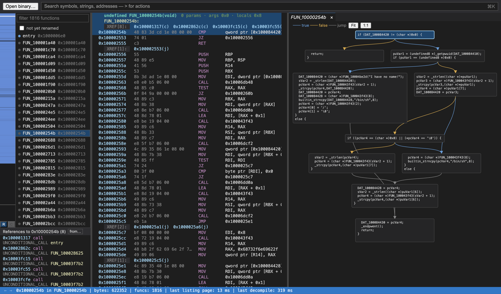

### Call graph (`Cmd+Shift+G`)
View > Call Graph (or the command bar) swaps the decompiler for the functions around the current one: callers above, callees below, two calls each way. Imports are dashed leaves, `×n` on an edge counts its call sites, each function carries the naming dot described under Key hints and colours (imports keep a dashed box in the library colour), and with coverage loaded each function says whether the shown runs reached it (**never ran** = 0×). Type a function into **routes to function…** and **Find routes** to see the ways from here to it: the shortest route and those one call longer. A click on a function goes there.


### Debugger (QEMU)
Start QEMU halted with its gdb stub, for example `qemu-system-arm -M lm3s6965evb -kernel fw.bin -S -gdb tcp::1234 -display none` (the test firmware is `sidecar/testdata/fw/fw.bin`), open the same image (a raw image at the base address it runs at, with the loader and language it needs; program addresses are runtime addresses), then Debug > Attach to QEMU… (host:port, default `localhost:1234`, and a load offset). The target stops where it is; the listing and decompiler jump to the stop and highlight the current row and line (the instructions behind that line are tinted in the listing), the **Registers** tab lists the program language's registers and marks the ones that changed since the last stop, and the status bar says `running`, `stopped at <address>` or `detached` (with why: target exited, connection lost; a stop on a fault says its signal). `F9` toggles a breakpoint on the listing cursor row or the decompiler line's first address (a click in the gutter does the same; they can be set before attaching and while the target runs), `F5` continues, `F6` pauses, Debug > Detach lets go. Errors are plain words: connection refused, unknown architecture (the target is not the program's processor), the target exited.

**Stepping.** `F7` steps one C statement over calls: the target runs instruction by instruction until the program counter reaches the start of another decompiler line (the same address mapping the coverage tint uses), runs called functions to their return, and stops early at a breakpoint, at a signal, or when the function returns (you land in the caller, right after the call). `F10` steps into a call, `Shift+F10` runs out of the function, `F8` steps one instruction. Where the function has no decompiler lines, `F7` steps one instruction; a step gives up after 20,000 instructions.

**Values.** The **Locals** tab and the grey `←` text after decompiler lines show the function's parameters, locals and the globals it uses with their values at the stop, and what they were before this step. Stack variables are read from the frame (stack position from Ghidra's stack depth analysis; where Ghidra does not know it, they are left out), globals from memory, register variables from the stop's registers: those carry a `?` because they are only right where the decompiler keeps the variable in that register. **Target Memory** reads memory at an address or register (`sp`) as a hexdump with the bytes that changed since the last read marked, or through a Ghidra data type: `uint[6]` or `/MyStruct` give one row per element or field.

**History.** Every stop is recorded. `Shift+F7` / `Shift+F8` move the registers, listing, decompiler and values back and forward through the recorded stops (the status bar says "recorded stop 2 of 5" and where the target really is); any step or continue returns to the live stop. While the target runs, Back shows the newest recorded stop and Forward returns to the running view. This is a view of what happened, not reverse execution: the target does not move back.

**Offset.** The attach dialog's load offset (hex, runtime address minus program address, default 0) is for an image that runs somewhere else than it was imported. Not part of this version: relocation by module, recording and real reverse execution; only QEMU's stub has been tried (Cortex-M3 and AArch64). `sidecar/testdata/fw/` and `fw64/` hold the small test programs the tests debug; [docs/DEVELOPMENT.md](docs/DEVELOPMENT.md) has the commands. How this relates to Ghidra's own debugger, and why Ghidorita talks to the gdb stub itself: [docs/DEBUGGER.md](docs/DEBUGGER.md).

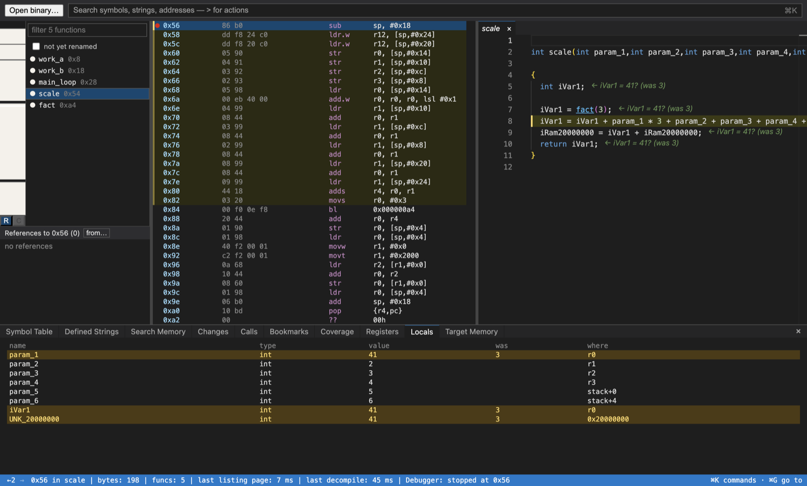

### Strings, symbols, memory search
View > Defined Strings (`Cmd+Shift+E`) lists strings with **Used by** (grouped per function, click to go there); *referenced only* is on by default, and a minimum length and a text filter narrow it. Symbol Table (`Cmd+Shift+Y`) filters by name (`*` and `?` wildcards) and kind and shows each symbol's namespace and source. Search Memory (`Cmd+Shift+F`) takes hex bytes with `??` wildcards or ASCII/UTF-16 text and streams results; **Cancel** keeps what was found, **Continue** resumes. All of them open in the dock under the panes; a click or Enter goes to the address.

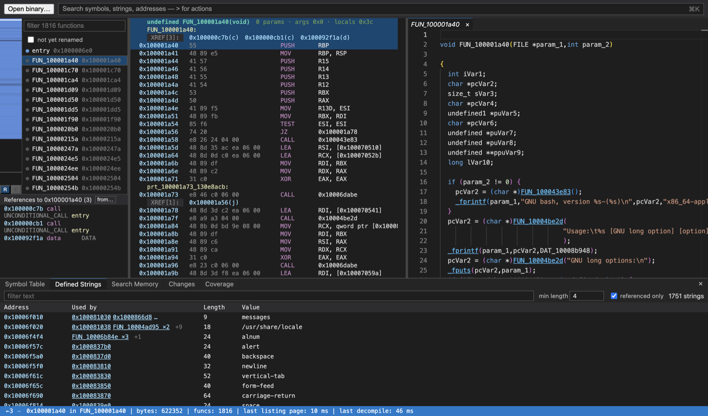

### Edit (Ghidra's default keys)
In the listing: `L` rename (or create a label), `;` comment (EOL, pre, post, plate or repeatable), `F` create function, `T` define data, `C` clear code. In the decompiler: `L` rename variable, parameter or function, `Cmd+L` retype, `;` comment; Edit > Edit Function Signature… and Auto Create Structure work on the cursor, Edit > Create Structure from Data… on the listing row. `Cmd+Z` / `Cmd+Shift+Z` undo and redo every edit. View > Changes (`Cmd+Shift+H`) lists the edits since the program was opened, saved or not; click one to go there.

### Data types (`Cmd+Shift+T`)
View > Data Type Manager browses the program's types and Ghidra's built-in types and creates structs, unions, enums, typedefs, pointers and categories. A struct opens as a field table: add, insert, delete, clear and reorder fields, change the size or packing, hide undefined filler, and **Apply at address…** lays it over memory. Rename and delete are undoable like any edit.

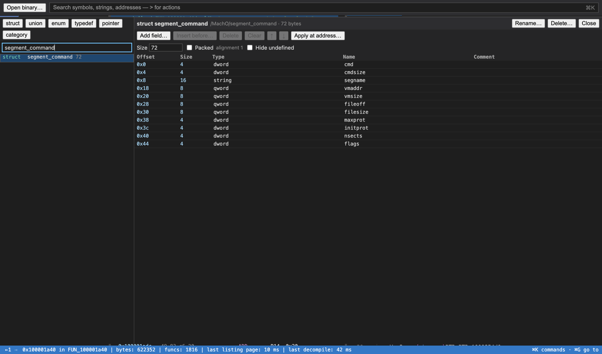

### Coverage runs
File > Load Coverage… reads a text file of executed code, one `0xSTART-0xEND` or `0xADDR` per line (`#` comments allowed). Load several runs: the first becomes run **A**, the second run **B**, so loading two shows their difference at once (View > Coverage picks other runs and renames them): the listing, decompiler, binary map and call graph tint code reached by both runs, only A (orange-red, a solid bar and an `A` in the gutter) or only B (orange-red, a hatched bar and a `B`; hatched stripes on the binary map), and the tab lists the functions reached by only one run.

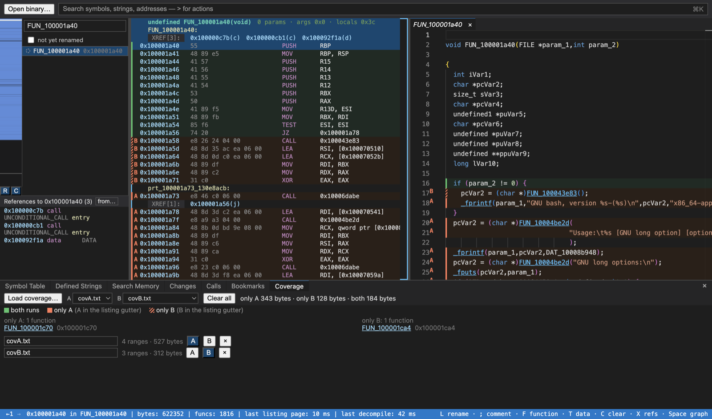

### Calls: callers and callees (`Cmd+Shift+J`)
View > Calls lists the callers and callees of the function at the cursor as a table (the Call Graph shows the same neighbourhood as a picture). An import stub shows what it forwards to and is marked *thunk to external*; externals have no address to go to. Click a row to navigate the listing and decompiler.

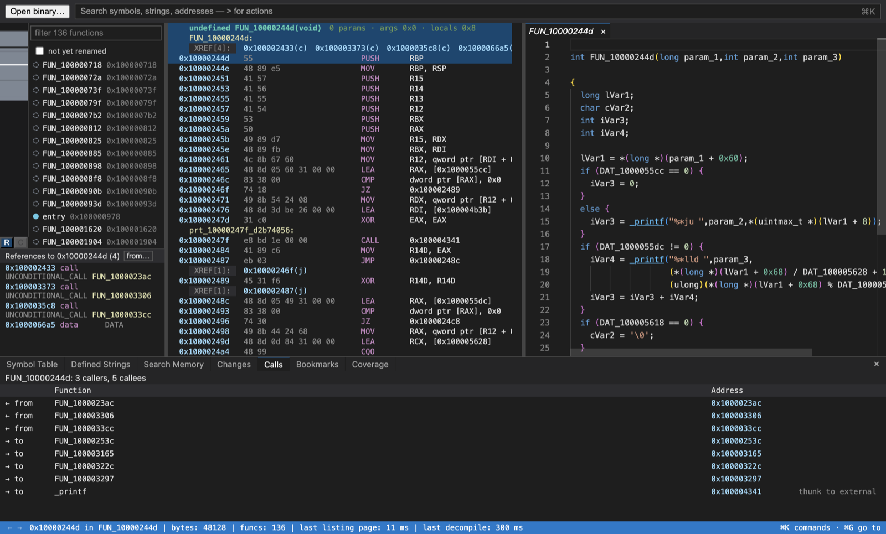

### Bookmarks (`Cmd+D`)
Edit > Add Bookmark… (`Cmd+D`) adds a note with a category at the cursor row or decompiler line; it shows as a marker in the listing. View > Bookmarks (`Cmd+Shift+B`) lists them, sortable by address, type or category, with a text filter and a type filter: it shows your own notes by default, and Ghidra's analyzer bookmarks (Analysis, Warning, Error, Info) are one dropdown away. × removes one. Adding and removing are undoable like any edit and are saved with the program.

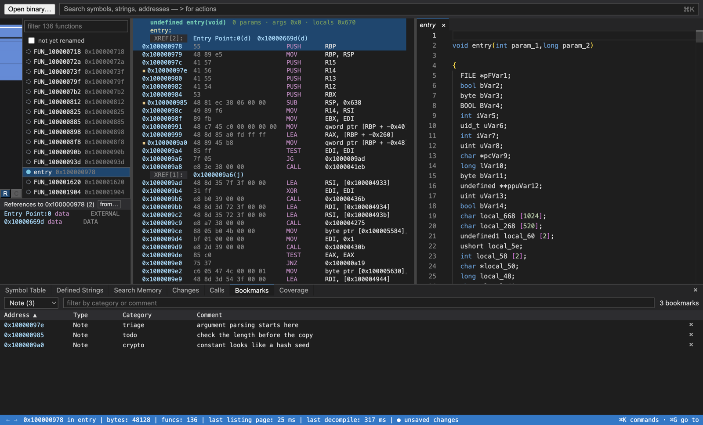

### Copy
Right-click a listing row for **Copy Address**, **Copy Bytes (Hex)** and **Copy Bytes (C Array)**; the function list and the decompiler have Copy Address, and the decompiler also **Copy Decompiled Function**. The same actions are in the Edit menu (`Cmd+Shift+C` copies the address, `Cmd+Alt+C` the bytes) and the command bar. `Cmd+C` stays the plain copy of a text selection.

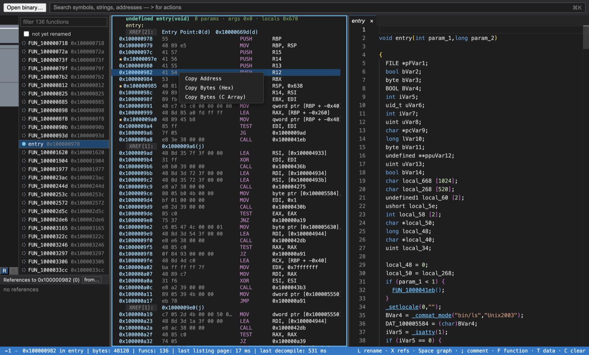

### Save and export
`Cmd+S` saves; edits are also saved when you open another program, close it or quit, and unsaved changes are snapshotted every two minutes so a crash loses little. Saving ends Ghidra's undo history. File > Export > Symbol Map (JSON)… or C Header… writes your names and types for reports or other tools; **Ghidra Archive (.gzf)…** writes the whole program, unsaved edits included, for Ghidra's own importer (refused while an analysis runs).

## Getting started

Needs JDK 25, Python 3.10+, Node LTS and a Ghidra build. Full steps in [docs/DEVELOPMENT.md](docs/DEVELOPMENT.md).

```bash
cd app && npm install && npm start
```

`npm start` launches PyGhidra by default; the same build can launch the independent read-only fixture provider. See [provider launch commands and implementation guide](PROVIDERS.md).

## Repository layout

| Path | Contents |
|---|---|
| `app/` | Electron app (main, preload, renderer) |
| `sidecar/` | Python JSON-RPC sidecar around PyGhidra, with pytest suite |
| `protocol.md`, `protocol.ts` | The wire protocol between the app and any provider |
| `PROVIDERS.md`, `app/providers/` | Running either provider, the read-only fixture format, how to add a provider |
| `bench/` | Benchmark scripts and results |
| `packaging/` | macOS bundle preparation (`npm run dist`) |
| `SPIKE_REPORT.md` | Design decisions and measurements per round |

## License

No license has been granted. All rights reserved by the author; being publicly visible does not give anyone permission to use, copy, modify or distribute this code.
