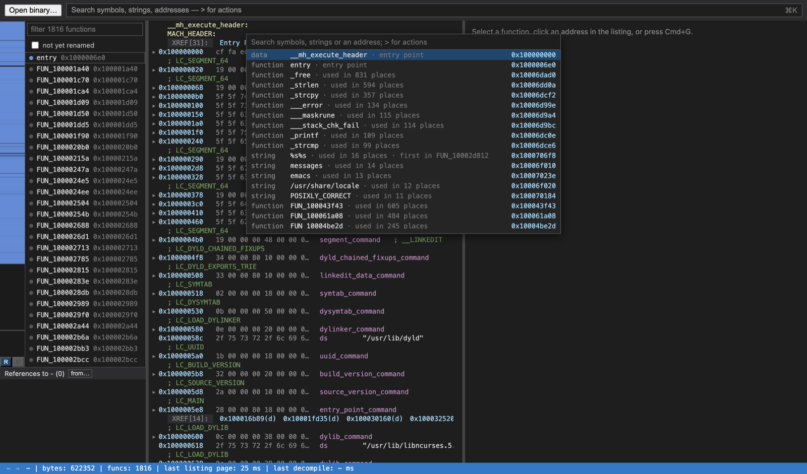
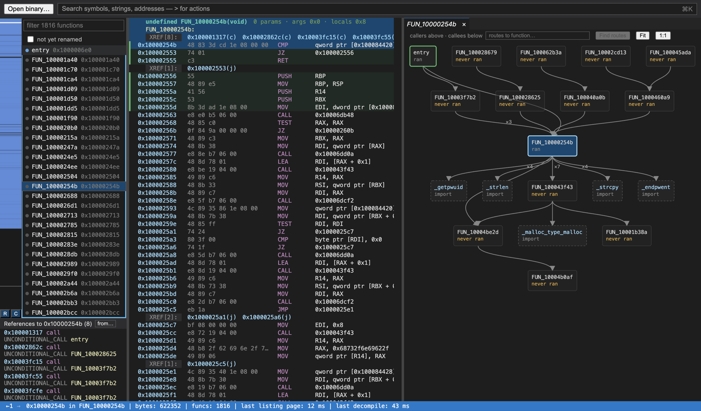

<p align="center"></p>

# Ghidrette

Ghidrette is a fast desktop reverse-engineering workspace on top of [Ghidra](https://github.com/NationalSecurityAgency/ghidra)'s analysis engine: Electron (TypeScript, React, Monaco) talking over a WebSocket JSON-RPC protocol to a headless Python sidecar (PyGhidra on the Ghidra JVM).

> **Status: early spike.** It works end to end on real binaries, but expect rough edges and breaking changes. Ghidrette is an independent project and is not affiliated with or endorsed by the Ghidra project or the NSA.


<sub>Function list, listing with cross-references and decompiler on `mysqldump` (arm64, 1,891 functions).</sub>

## Features and how to use them

Shortcuts are shown for macOS (use Ctrl on other platforms). Screenshots: `/bin/bash` and `/usr/bin/zip` (x86-64 Mach-O).

### Open a binary
File > Open Binary… (`Cmd+O`), or pick a program from the start screen's project list. Before anything is analysed, an import card shows what the file is: format, architecture, entry point, size, an entropy strip over the whole file and every section with its size and entropy, so packed or encrypted regions stand out. Loader, language, compiler, base address and the Full/Fast analysis profile sit behind **Advanced options…**. Analysis is stored per file (sha256), so reopening skips it.


### Command bar (`Cmd+K`)
One bar for jumping, searching and actions. Empty, it lists ranked leads (entry point, the most used imports, strings and functions) with the reason each ranks high; source-file paths (`__FILE__` in asserts) and very short words are left out of the string leads. Type to search symbols, strings or an address; string hits show where they are used. Start with `>` for actions (rename, retype, open a panel, load coverage, …). `Cmd+G` goes straight to an address; Back/Forward (`Cmd+[` / `Cmd+]`) live in the status bar.



### Read: function list, binary map, listing, decompiler
The function list filters by name; tick **not yet renamed** to see only functions nobody has named. The vertical binary map beside it shows the whole file; click or drag to go there, and toggle its layers with **R** (renamed functions) and **C** (coverage); hovering a toggle says what its colours mean. The listing shows function headers, comments, `XREF[n]` annotations (click to follow) and folded structures; the decompiler follows the cursor and opens one tab per function. `X` on a listing row or decompiler token opens its references in the panel under the function list (screenshot at the top of this page).

### Control-flow graph (`Space`)
`Space` in the listing or decompiler (or View > Control-Flow Graph) swaps the decompiler for the function's graph. Blocks show C where the decompiler maps them, otherwise assembly; edges are blue (true), orange (false) and grey (jump). A graph that would only fit at an unreadable size opens at actual size on the cursor's block instead; **Fit** shows the whole graph, **1:1** returns to the cursor's block, and the view follows the cursor when it moves to a block off screen. Wheel zooms, drag pans, a click on a block moves the cursor there.


### Call graph (`Cmd+Shift+G`)
View > Call Graph (or the command bar) swaps the decompiler for the functions around the current one: callers above, callees below, two calls each way. Imports are dashed leaves, `×n` on an edge counts its call sites, a pink dot marks functions you named, and with coverage loaded each function says whether the shown runs reached it (**never ran** = 0×). Type a function into **routes to function…** and **Find routes** to see every way from here to it: the shortest route and those one call longer. A click on a function goes there.



### Strings, symbols, memory search
View > Defined Strings (`Cmd+Shift+E`) lists strings with **Used by** (grouped per function, click to go there); *referenced only* is on by default. Symbol Table (`Cmd+Shift+Y`) filters by kind and shows each symbol's source. Search Memory (`Cmd+Shift+F`) takes hex bytes with `??` wildcards or ASCII/UTF-16 text. All of them open in the dock under the panes.


### Edit (Ghidra's default keys)
In the listing: `L` rename, `;` comment, `F` create function, `T` define data, `C` clear code. In the decompiler: `L` rename variable/function, `Cmd+L` retype, `;` comment; Edit > Edit Function Signature… and Auto Create Structure work on the cursor. `Cmd+Z` / `Cmd+Shift+Z` undo and redo, `Cmd+S` saves. View > Changes (`Cmd+Shift+H`) lists every edit; View > Data Type Manager (`Cmd+Shift+T`) creates and edits structs, unions, enums and typedefs.

### Coverage runs
File > Load Coverage… reads a text file of executed code, one `0xSTART-0xEND` or `0xADDR` per line (`#` comments allowed). Load several runs: the first becomes run **A**, the second run **B**, so loading two shows their difference at once (View > Coverage picks other runs): the listing, decompiler and binary map tint code reached by both runs, only A (orange, `A` in the gutter) or only B (blue, `B`), and the tab lists the functions reached by only one run.


### Export
File > Export > Symbol Map (JSON)… or C Header… writes your names and types for reports or other tools.

## Getting started

Needs JDK 25, Python 3.10+, Node LTS and a Ghidra build. Full steps in [docs/DEVELOPMENT.md](docs/DEVELOPMENT.md).

```bash
cd app && npm install && npm start
```

`npm start` launches PyGhidra by default; the same build can launch the independent read-only fixture provider. See [provider launch commands and implementation guide](PROVIDERS.md).

## Repository layout

| Path | Contents |
|---|---|
| `app/` | Electron app (main, preload, renderer) |
| `sidecar/` | Python JSON-RPC sidecar around PyGhidra, with pytest suite |
| `protocol.md`, `protocol.ts` | The wire protocol between the app and any provider |
| `PROVIDERS.md`, `app/providers/` | Running either provider, the read-only fixture format, how to add a provider |
| `bench/` | Benchmark scripts and results |
| `packaging/` | macOS bundle preparation (`npm run dist`) |
| `SPIKE_REPORT.md` | Design decisions and measurements per round |

## License

No license has been granted. All rights reserved by the author; being publicly visible does not give anyone permission to use, copy, modify or distribute this code.
